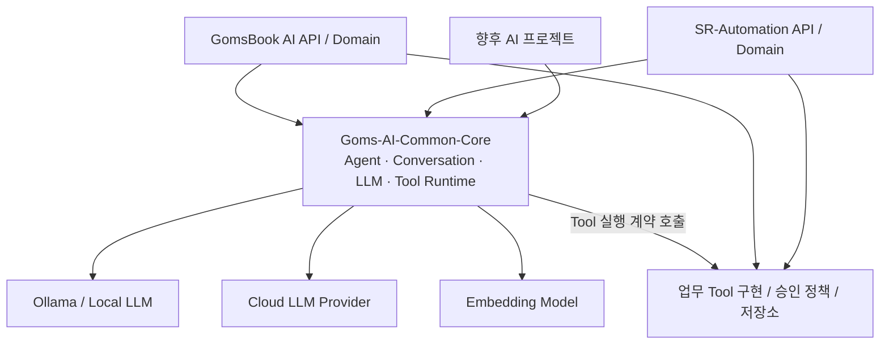

# Goms-AI-Common-Core

> **공통 AI Agent 실행 및 AI 모델 송수신 전담 Core**  
> Java 21 · Maven · Framework-independent Core · V1.0 설계 기준

## 1. 프로젝트 개요

`Goms-AI-Common-Core`는 GomsBook AI, SR 운영 자동화 등 여러 AI 기반 프로젝트에서 반복되는 **AI Agent 실행과 모델 통신 기능**을 단일 Maven 라이브러리로 통합하기 위한 공통 Core이다.

핵심 원칙은 다음과 같다.

> **모든 AI 모델 요청·응답과 공통 Agent 실행 흐름은 `Goms-AI-Common-Core`에서 처리하고, EPUB·SR 등 업무별 기능과 인프라 접근은 개별 프로젝트에 둔다.**

이 문서는 **V1.0의 목표 구조와 구현·이관 기준**을 정의한다. 문서에 나오는 인터페이스·클래스·패키지 예시는 구현 목표이며, 현재 소스에 모두 구현되어 있음을 의미하지 않는다.

### 목표

- LLM 및 Embedding 모델 호출 경로를 공통 Core로 일원화한다.
- Agent 실행, 모델 선택, 메시지 처리, Tool Calling, 응답 파싱·예외 처리를 재사용한다.
- 프로젝트마다 중복되는 Ollama·클라우드 모델 연동 소스를 제거한다.
- 업무 도메인과 무관한 Core를 유지해 신규 AI 프로젝트에 동일하게 적용한다.
- Core는 Spring Boot 없이 독립 빌드·단위 테스트가 가능하도록 설계한다.

## 2. 적용 대상 및 책임 경계

### 공통 Core에 포함하는 기능

| 영역 | 공통 Core 책임 |
| --- | --- |
| `agent` | Agent 실행 수명주기, 공통 실행 컨텍스트, Agent/Tool 오케스트레이션, 실행 상태 및 결과 |
| `conversation` | LLM에 전달할 공통 메시지·대화 컨텍스트 모델, 요청용 대화 이력 구성 |
| `llm` | 모델 라우팅, 채팅·임베딩 요청/응답 DTO, provider 클라이언트, 스트리밍, 사용량·오류 표준화 |
| `json` | 모델 JSON 응답 파싱, 유효성 검사 및 공통 직렬화 보조 |
| `logging` | 모델 호출·Agent 실행에 필요한 공통 진단 이벤트 및 추적용 인터페이스 |
| `tool` | Tool 정의·등록·선택·호출·결과 모델과 공통 실행 규칙 |
| `util` | 위 기능에서 실제 공통으로 사용하는 최소한의 유틸리티 |

**Embedding 모델 호출**은 `llm` 영역의 공통 모델 I/O로 다루되, 검색 색인·벡터 DB·검색 파이프라인은 포함하지 않는다.

### 개별 프로젝트로 분리하는 기능

| 영역 | 배치 위치 및 원칙 |
| --- | --- |
| EPUB 읽기·생성·검증·출판 | GomsBook AI의 도메인 Core/Service |
| `epub.service` | 공통 Core에서 제외하고 EPUB 프로젝트로 이관 |
| 현재 프로젝트 선택 및 EPUB 프로젝트 경로 관리 | GomsBook AI에서 관리 (`project` 패키지의 도메인 구현 이관) |
| SR 분류 정책·워크플로·승인·업무 상태 | SR-Automation-Core |
| RAG 인덱싱·검색·평가·검색 결과 병합 | 해당 프로젝트의 RAG Core/Infra |
| OpenSearch·Qdrant·PostgreSQL 접근 | 프로젝트별 Infra |
| REST Controller·인증·Spring Boot 설정·Bean 조립 | 프로젝트별 API/Infra |
| 실제 EPUB Tool / SR Tool 구현 | 각 도메인 프로젝트; 공통 Core의 Tool 계약을 구현 |
| 실제 승인 정책·권한·감사 저장 | 각 프로젝트에서 정의; 공통 Agent 실행기는 정책 결과를 준수 |

> **구분 기준:** 모델과 Agent 실행 그 자체에 관한 기능은 공통 Core, 모델이 수행하는 **업무의 의미와 데이터**는 개별 프로젝트 소유로 둔다.

## 3. 전체 아키텍처



### 기본 호출 흐름

```text
React / 외부 요청
    ↓
각 프로젝트 API (인증, 권한, HTTP/SSE Endpoint)
    ↓
각 프로젝트 Application Service (업무 요청 조립)
    ↓
Goms-AI-Common-Core
    ├─ Agent 선택 및 실행
    ├─ Conversation / Message 정규화
    ├─ Model Routing / LLM Request 생성
    ├─ 공통 Model Client → 실제 LLM / Embedding 모델
    ├─ Model Response / Streaming 이벤트 처리
    ├─ Tool Calling 판단 및 공통 호출 제어
    │    └─ 프로젝트가 등록한 업무 Tool 실행
    └─ 공통 Agent Response / Usage / Trace 반환
    ↓
각 프로젝트 API (응답 DTO 변환 및 전달)
```

**허용되는 의존성 방향:** `Application(API/Infra) → Goms-AI-Common-Core`  
**금지되는 의존성 방향:** `Goms-AI-Common-Core → GomsBook/SR 도메인 또는 API/Infra`

공통 Core 내부는 자체적으로 모델의 HTTP·스트리밍 통신 Adapter를 보유할 수 있지만, 외부 도메인 프로젝트의 구현 클래스를 직접 참조하지 않는다. Tool·승인·기록 저장은 인터페이스를 통해 외부 구현을 주입한다.

## 4. 패키지 구조 (V1.0 권장안)

Base package: `kr.co.goms.ai`

```text
Goms-AI-Common-Core/
├─ pom.xml
├─ README.md
└─ src/
   ├─ main/java/kr/co/goms/ai/
   │  ├─ agent/
   │  │  ├─ AgentContext.java
   │  │  ├─ AgentRequest.java
   │  │  ├─ AgentResponse.java
   │  │  ├─ AgentExecutor.java
   │  │  └─ IAgentApprovalPolicy.java
   │  ├─ conversation/
   │  │  ├─ ChatMessage.java
   │  │  ├─ MessageRole.java
   │  │  └─ ConversationContext.java
   │  ├─ llm/
   │  │  ├─ ILlmClient.java
   │  │  ├─ IEmbeddingClient.java
   │  │  ├─ IModelRouter.java
   │  │  ├─ model/
   │  │  │  ├─ LlmRequest.java
   │  │  │  ├─ LlmResponse.java
   │  │  │  ├─ EmbeddingRequest.java
   │  │  │  ├─ EmbeddingResponse.java
   │  │  │  └─ ModelUsage.java
   │  │  ├─ provider/
   │  │  │  ├─ OllamaLlmClient.java
   │  │  │  └─ OllamaEmbeddingClient.java
   │  │  └─ stream/
   │  │     └─ LlmStreamEvent.java
   │  ├─ json/
   │  │  └─ ModelJsonParser.java
   │  ├─ logging/
   │  │  ├─ AgentExecutionEvent.java
   │  │  └─ IAgentExecutionLogger.java
   │  ├─ tool/
   │  │  ├─ AgentTool.java
   │  │  ├─ AgentToolRequest.java
   │  │  ├─ AgentToolResult.java
   │  │  └─ AgentToolRegistry.java
   │  └─ util/
   └─ test/java/kr/co/goms/ai/
```

위 파일명은 **설계 예시**이다. 이관 시에는 기존 GomsBook AI에서 검증된 클래스명·인터페이스를 우선 검토하고, 공개 API 호환성과 역할 분리를 기준으로 최종 확정한다.

### 기존 패키지 정리 기준

| 기존 패키지 | V1.0 처리 | 판단 기준 |
| --- | --- | --- |
| `agent` | **유지·공통화** | Agent 실행 및 상태 관리에 한정 |
| `conversation` | **선별 유지** | 메시지·컨텍스트는 공통, DB 이력 저장 구현은 이관 |
| `epub.service` | **전부 이관** | EPUB 전용 서비스는 공통 AI 통신 책임 아님 |
| `json` | **선별 유지** | 모델 JSON/Tool 인수 처리 관련만 유지 |
| `llm` | **유지·공통화** | 모델 요청·응답의 유일한 통로 |
| `logging` | **선별 유지** | 공통 이벤트/계약만 유지, DB·파일 저장 구현은 외부 |
| `project` | **도메인 구현 이관** | EPUB 프로젝트·SR 프로젝트 처리 제외; 공통 실행 ID는 `AgentContext` 등으로 처리 |
| `rag` | **도메인 기능 이관** | RAG 인덱싱·Retrieval·평가는 각 프로젝트에 둠 |
| `tool` | **계약·실행기 유지** | Tool Calling 공통 런타임만 유지; 도메인 Tool 구현 제외 |
| `util` | **최소화** | 다른 패키지에 종속된 범용성 없는 유틸은 이관 |

## 5. 주요 설계 규칙

### 5.1 모델 호출 단일화

- **모든 Chat/Completion/Embedding 모델 호출은 `llm` 패키지의 공통 Client를 통한다.**
- 도메인 프로젝트에서 Ollama API, OpenAI 호환 API 등에 직접 HTTP 요청을 생성하지 않는다.
- Provider별 요청·응답 차이는 공통 Core의 Adapter에서 표준 DTO로 변환한다.
- 모델명, Endpoint, Timeout, 인증 정보는 각 실행 프로젝트의 설정에서 주입한다.
- 시스템 전체에 하나의 모델을 고정하지 않고 **Agent/용도별 모델 라우팅**을 지원한다.

예: GomsBook EPUB Agent와 Coding Agent는 서로 다른 모델을 사용할 수 있으며, SR-Automation도 동일한 Core를 사용하면서 자체 모델 정책을 지정한다.

### 5.2 Agent 실행 표준화

공통 실행 과정은 다음 단계를 따른다.

1. 요청 검증 및 공통 실행 컨텍스트 생성
2. Agent/모델 설정 조회
3. 메시지 및 필요 컨텍스트 구성
4. 모델 호출 (일반/스트리밍)
5. 모델 응답·Tool Call 식별 및 표준화
6. 승인/권한 정책 확인 후 등록된 Tool 실행 (필요한 경우)
7. Tool 결과 재전달 및 다음 모델 호출 (필요한 경우)
8. 최종 응답, 사용량, 실행 이벤트 반환

Tool 호출 반복 횟수, 취소, 타임아웃, 오류 전파는 공통 실행 규칙으로 제어한다. 모델이 지시한 Tool 실행은 **자동 허용하지 않고**, 프로젝트가 제공한 정책 및 사용자 승인 결과를 따른다.

### 5.3 Tool 경계

`AgentTool`과 Tool Registry는 공통 Core에 포함한다. 다음 구현은 개별 프로젝트에 둔다.

- `ReadEpubPackageTool`, `CreateEpubTool` 등 EPUB Tool
- SR 조회·분류·소스 변경·배포 Tool
- 프로젝트별 파일/DB 접근 Tool

공통 Core는 Tool의 이름, 입력 스키마, 호출, 결과 전달 방식만 알고, EPUB 구조나 SR 업무 규칙을 알지 못한다.

### 5.4 Conversation 경계

공통 Core에는 `system` / `user` / `assistant` / `tool` 메시지와 요청용 대화 컨텍스트를 둔다. 실제 대화 이력 저장, 프로젝트별 세션 관리, 접근 통제, 보존 정책은 소비 프로젝트의 책임이다.

### 5.5 Logging 경계

공통 Core는 최소한 다음 추적 필드를 지원하도록 설계한다.

- `projectId`, `conversationId`, `runId`, `agentId`
- `model`, `provider`, `requestId`, `toolName`
- 요청 시작/종료, 소요 시간, 토큰 사용량, 오류 코드

로그 저장 위치(DB, 파일, 외부 관제)는 각 프로젝트에서 결정한다. 프롬프트 전문, 비밀번호, API Key, 개인정보는 기본 로깅 대상에서 제외하고 필요 시 별도의 마스킹·감사 정책을 적용한다.

### 5.6 JSON · 오류 · 스트리밍

- JSON 파싱 실패와 스키마 위반을 표준 오류 형태로 반환한다.
- 모델의 비정상 응답, 연결/읽기 Timeout, Rate Limit, 취소를 구분한다.
- 재시도는 안전한 **모델 네트워크 요청**에 한정하고, Tool 실행처럼 부작용이 있는 작업은 무조건 자동 재시도하지 않는다.
- 스트리밍 이벤트는 공통 형태로 만들고 API에서 이를 SSE/WebSocket 등으로 노출한다.
- 모델 요청 본문·Tool 인수에는 보안 검증, 크기 제한, 허용 목록 정책을 적용한다.

## 6. Maven 구성 및 사용하는 방법

### 권장 빌드 기준

| 항목 | 기준 |
| --- | --- |
| Language | Java 21 |
| Build | Maven |
| Packaging | `jar` |
| Core framework | 순수 Java 기반 (Spring Boot 의존 최소화 또는 제외) |
| Spring Boot 실행 | 각 프로젝트의 API 애플리케이션 |
| 버전 관리 | 공통 라이브러리 버전 고정 및 호환성 관리 |

아래 좌표는 **예시**이며, 실제 `pom.xml`의 `groupId`, `artifactId`, `version`과 반드시 일치시켜야 한다.

```xml
<dependency>
    <groupId>kr.co.goms</groupId>
    <artifactId>Goms-AI-Common-Core</artifactId>
    <version>1.0.0-SNAPSHOT</version>
</dependency>
```

독립 Maven 프로젝트라면 먼저 Core 프로젝트에서 설치한다.

```bash
mvn clean install
```

그 후 GomsBook AI, SR-Automation 등의 소비 프로젝트에서 Maven 의존성을 추가한다. **서로 다른 독립 Maven 프로젝트**이므로 상위 폴더에 프로젝트를 함께 두었다는 이유만으로 자동으로 의존성이 해결되지는 않는다. 로컬 개발에서는 `mvn install`을 사용하고, 배포 환경에서는 사내 Maven Repository 등에서 버전을 공급한다.

### 구성 원칙

- Core는 `@SpringBootApplication`이나 실행용 `main()`을 갖지 않는 라이브러리로 유지한다.
- API 프로젝트의 Spring 설정 클래스에서 Client, Router, Tool, Logger 등 구현체를 조립한다.
- 클라우드 인증 정보와 로컬 Ollama URL은 Core에 하드코딩하지 않는다.
- Model Provider 교체 시 도메인 서비스의 코드 수정이 발생하지 않도록 한다.

## 7. 사용 예시 (개념 흐름)

```text
[프로젝트 API]
  ├─ AgentRequest 생성
  ├─ 프로젝트별 IModelRouter / Tool / 승인 정책 연결
  └─ AgentExecutor.execute(request)
       ├─ ILlmClient → Ollama 또는 Cloud API
       ├─ 응답의 Tool Call 처리 → 등록된 프로젝트 Tool
       └─ AgentResponse 반환
```

> 이 예시는 연동 구조를 설명하기 위한 것으로, **구체적인 메서드 시그니처는 실제 공통 API 확정 후 작성**한다.

## 8. 반드시 지킬 의존성 규칙

1. 공통 Core의 Java 패키지는 `kr.co.goms.ai.*`를 사용한다.
2. 공통 Core에서 GomsBook의 `epub.*`, SR-Automation의 `sr.*` 등 도메인 패키지를 import하지 않는다.
3. 공통 Core에서 프로젝트별 JPA Repository, Controller, OpenSearch Client를 직접 의존하지 않는다.
4. AI 모델 통신은 공통 `llm` Client에서만 수행한다.
5. 도메인 Tool과 승인 정책은 **외부 주입**하며, 공통 Core는 인터페이스에만 의존한다.
6. 도메인 모델을 공통 DTO로 무리하게 통합하지 않는다.
7. 공개 인터페이스 변경은 소비 프로젝트의 호환성을 검증한 후 버전을 올린다.
8. 기존 공통 로직을 Core로 이관한 뒤, 소비 프로젝트의 중복 구현을 제거한다.

## 9. 마이그레이션 순서

| 단계 | 작업 | 완료 조건 |
| --- | --- | --- |
| 1 | 기존 GomsBook AI의 `agent`, `llm`, `conversation`, `tool` 의존 관계 분석 | 도메인 의존 클래스 목록 확정 |
| 2 | 공통 DTO 및 Port(인터페이스) 추출 | Java 21 단독 컴파일 성공 |
| 3 | 모델 Provider Adapter 및 Model Routing 이관 | 기존 모델 일반/스트리밍 응답 일치 검증 |
| 4 | Agent Executor / Tool Calling 런타임 이관 | 기존 Agent 시나리오 회귀 테스트 통과 |
| 5 | JSON·Logging 공통 기능 이관 | 공통 예외·추적 이벤트 확인 |
| 6 | `epub.service`, `project`, `rag` 도메인 코드 분리 | Core에서 도메인 import 0건 |
| 7 | GomsBook AI에서 공통 Core Maven 의존성 연결 | 기존 기능 정상 동작, 중복 통신 구현 제거 |
| 8 | SR-Automation에서 동일 Core 의존성 연결 | SR Agent가 공통 모델 통신으로 실행 |
| 9 | 테스트·버전·배포 정책 확정 | 소비 프로젝트별 독립 빌드 및 통합 테스트 통과 |

기존 코드를 일괄 이동하기보다 **공통 API 추출 → Provider 통신 이관 → Agent 런타임 이관 → 소비 프로젝트 전환** 순서로 진행한다.

## 10. 테스트 및 품질 게이트

### 단위 테스트

- `AgentExecutor`의 정상 실행, Tool 호출, Tool 반복 제한, 취소·실패 처리
- Model Router의 Agent별 모델 결정
- Provider 응답의 표준 DTO 변환 및 JSON 오류 처리
- 모델 Timeout, Rate Limit, 재시도 가능 여부
- 스트리밍 델타 순서, 완료 이벤트 및 중간 연결 종료
- Tool 승인 거부 시 실행 방지

### 통합 테스트

- 로컬 Ollama를 이용한 실제 요청·응답 확인
- Chat과 Embedding 모델 호출 분리 검증
- GomsBook AI 기존 Agent / EPUB Tool 연동 회귀 테스트
- SR-Automation Agent 연동 테스트
- 프롬프트·인증 토큰 등 민감 정보 로그 노출 여부 검사

### V1.0 완료 기준 (Definition of Done)

- [ ] Common Core 단독 `mvn clean verify` 성공
- [ ] GomsBook AI / SR-Automation 양쪽에서 동일 Core 참조
- [ ] 프로젝트별 직접 LLM·Embedding HTTP 통신 제거
- [ ] 공통 Agent 실행/Tool Calling 시나리오 통과
- [ ] Core의 EPUB·SR 등 업무 도메인 코드 의존성 0건
- [ ] 모델별 설정과 비밀 정보가 소비 프로젝트에서 주입됨
- [ ] 기존 주요 기능에 대한 회귀 테스트 통과

## 11. 버전 관리 원칙

- `1.0.0-SNAPSHOT`: 초기 분리·통합 검증 단계
- `1.0.0`: 공통 API와 주요 모델 통신 경로의 안정화 완료
- 호환되지 않는 공개 API 변경: Major 버전 증가
- 하위 호환 기능 추가: Minor 버전 증가
- 버그 수정: Patch 버전 증가

최초 배포 시에는 공개 DTO와 Port 변경을 최소화하고, 프로젝트별 버전 호환성을 README 또는 변경 이력에 기록한다.

## 12. 최종 원칙

> **Goms-AI-Common-Core = 공통 Agent Runtime + 공통 LLM/Embedding Model I/O + 공통 Tool Calling 계약**
>
> **GomsBook AI = EPUB 업무 로직 / Tool 구현**  
> **SR-Automation = SR 업무 로직 / Tool 구현**  
> **각 프로젝트 API/Infra = REST·설정·저장소·업무 인프라**

새로운 AI 프로젝트를 추가할 때는 공통 Core를 Maven 의존성으로 연결하고, 해당 프로젝트의 Agent 설정·도메인 Tool·정책만 추가하는 구조를 목표로 한다.
